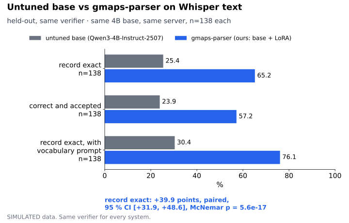
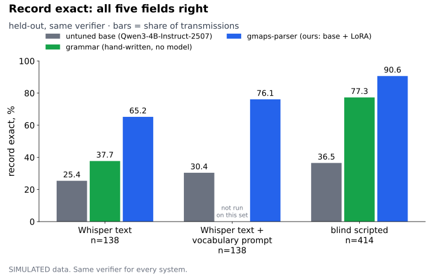
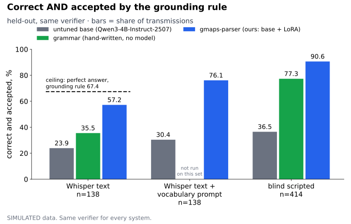
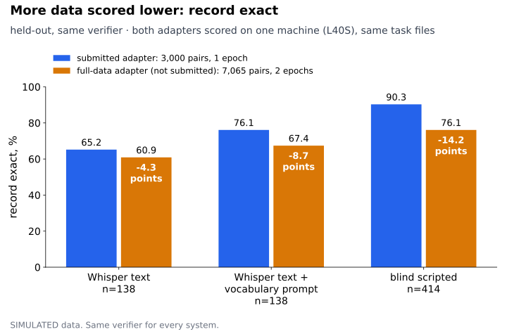
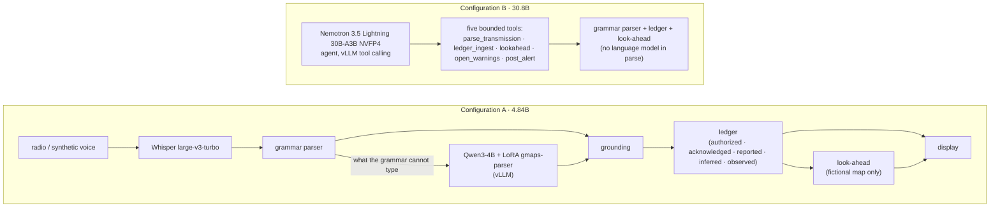
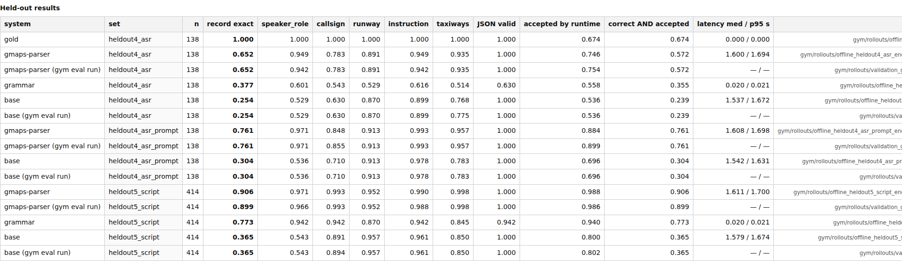
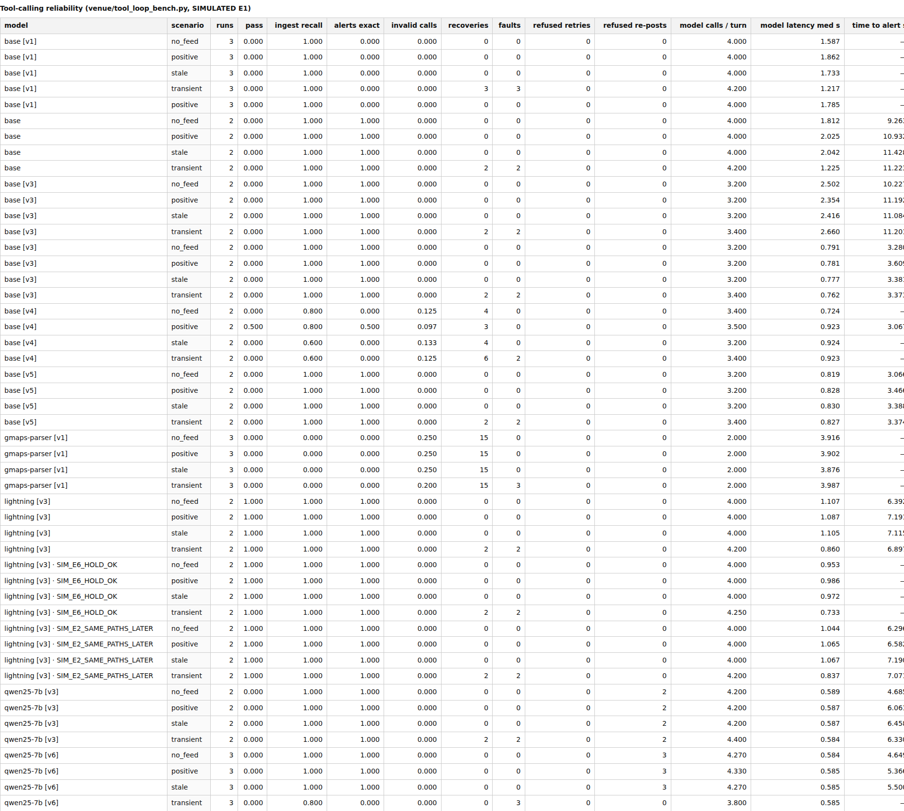

# GMAPS: Ground Movement Awareness and Prediction System

## Open Agent Hackathon 2026 (new work on branch `open-agent-2026`)
**Submission:** [`docs/OPEN_AGENT_2026_SUBMISSION.md`](docs/OPEN_AGENT_2026_SUBMISSION.md). It covers the pre-existing work declaration (everything up to `e97a9a1`), the sponsor status, the traces and the limits. Everything is SIMULATED (fictional SIM-1 map).

- **What is new:** an agent loop (`agent/open_agent_loop.py`) with these roles: Planner → Executor → Evaluator (grounding rule, one retry, escalation) → Risk (SIM-1 look-ahead; "prediction unavailable" when positions are stale) → Explainer (Nemotron via Nightshift) → Alert (display only).
- **Providers:** `NightshiftLLM` (`GMAPS_PROVIDER=nightshift`) and offline replay (`sample`); the Raleigh `local` path is unchanged.
- **Traces:** one JSON line per step (`tools/show_trace.py`).
- **Not integrated:** Meterless and Zetaris. Local fallbacks run in their place, and the docs say so.
- **Dependencies:** none added (Python 3.9+, stdlib only); `requirements.txt` is unchanged. Credentials come from environment variables only (see `.env.example`).
```
python3 demo/run_open_agent.py --scenario all --provider sample      # no key, no network
demo/record_open_agent.sh                                             # live: needs NIGHTSHIFT_BASE_URL / _API_KEY / _MODEL
python3 tools/show_trace.py samples/open_agent/traces/SIM_E1_CROSS_DURING_ROLLOUT.jsonl --calls
python3 tests/run_all.py                                              # snapshot checks + open-agent tests
```

### Local-execution proof (new)
`python3 tools/local_proof.py -- demo/run_open_agent.py --scenario all --provider nightshift` wraps any run and records:
- every `connect()` made by its Python processes (an auditor injected for that run only, so nothing is missed between samples);
- every non-loopback connection on the machine during the run;
- GPU utilization, power and memory from `nvidia-smi`, with each model call from the trace marked on the chart.

It writes `runs/proof/local_<ts>.json` and a self-contained `.html` page, with the verdict "loopback only" or a list of exactly what left the machine. `demo/record_open_agent.sh` runs the live scenarios under it.

### Animated LaGuardia view (new)
`ui_scaffold/lga_scene.html` replays the six scripted SIM scenarios on the real LaGuardia layout, with AS-IS and WITH GMAPS side by side on one clock. Run `cd ui_scaffold && python3 -m http.server 8765 --bind 127.0.0.1`, then open `lga_scene.html?s=SIM_E1_CROSS_DURING_ROLLOUT`.

- **Layout:** OpenStreetMap runways, taxiways, aprons and hold bars (ODbL), placed in the FAA AL-289 diagram frame. Rebuild with `python3 tools/build_lga_scene.py`.
- **Placement:** SIM runway 36 becomes LGA runway 04 (landing SW→NE), and SIM taxiway K becomes LGA taxiway G. The SIM hold lines are mapped onto G's real hold bars, 79 m and 74 m from the runway.
- **Ledger:** re-run on LGA identifiers ("runway four", "Golf") against `data/airports/klga.graph.json`. It fires the same rules at the same seconds as SIM-1 in all six scenarios (`ui_scaffold/lga/index.json`).
- **Look-ahead:** the SIM-1 computation, drawn on LGA geometry.
- **Traffic is fictional** (SimAir 212, Rescue 7) and depicts no real event. Taxiway D is deliberately not used, because the repo's historical LGA fixture involves D.
- **Controls:** play/pause, speed, scrub, auto camera (whole airport, then the G crossing), drag to pan, wheel to zoom, Space and the arrow keys.

### The fine-tuned parser: pre-existing, published before this hackathon
Model [darkstar008/gmaps-parser-qwen3-4b-lora](https://huggingface.co/darkstar008/gmaps-parser-qwen3-4b-lora) · dataset [darkstar008/gmaps-parser-qwen3-4b-lora-data](https://huggingface.co/datasets/darkstar008/gmaps-parser-qwen3-4b-lora-data) · cards and charts copied in [`docs/model_card/`](docs/model_card/README.md).

GMAPS runs two small models that do real work in one loop:
- **Fine-tuned 4B parser** (Qwen3-4B + LoRA `gmaps-parser`, local vLLM on the DGX Spark, pre-existing). It types the transmissions the grammar cannot.
- **NVIDIA Nemotron 30B via Nightshift** (new). It does the residue parse and the two-sentence explanations in the agent loop.

The Raleigh 33B cap does not apply here, so they run as one system.

| held-out set (SIMULATED, same verifier) | n | untuned base | grammar | **gmaps-parser** |
|---|---|---|---|---|
| Whisper text (heldout4_asr), record exact | 138 | 0.254 | 0.377 | **0.652** |
| blind scripted (heldout5_script), record exact | 414 | 0.365 | 0.773 | **0.906** |
| Whisper text, correct AND accepted by the runtime | 138 | 0.239 | 0.355 | **0.572** |

- **Paired comparison on Whisper text:** +39.9 points, 95 % CI [+31.9, +48.6], McNemar p = 5.6e-17 (`docs/PAIRED_STATS.md`).
- **Correct and accepted are reported separately:** a perfect answer passes the runtime grounding rule only 67.4 % of the time on Whisper text.
- **A second adapter trained on all 7,065 pairs for 2 epochs scored lower** on every held-out set (0.609 / 0.674 / 0.761, `eval/results/brev/`). It is reported, and the 3,000-pair adapter is the one published.



*Same base model, same server, same transmissions: the adapter against the untuned base, with the paired interval and the McNemar test.*



*Record exact (all five fields right) on three held-out sets: untuned base, hand-written grammar and gmaps-parser, scored by the same verifier.* This chart carries both the blind-set bars and the grammar baseline.



*Correct AND accepted by the runtime grounding rule. The dashed line is what a perfect answer reaches on Whisper text: the ceiling the speech recognizer imposes.*



*A second adapter trained on all pairs for 2 epochs scored lower on every held-out set. Both were scored on one machine with the same task files; the 3,000-pair adapter is the one published here.*

### New this week: Nemotron via Nightshift vs the fine-tuned 4B on the same held-out set
`eval/run_provider_compare.py` runs the same 138 Whisper-text transmissions with the same prompt and verifier. **Status at push time: not run.** The build session had no Nightshift credentials, so there are no numbers yet. Run it on the Spark (see `docs/OPEN_AGENT_2026_SUBMISSION.md`). The chart `docs/model_card/open_agent_2026/nemotron_vs_parser.png` is drawn only from the resulting JSON.

## What GMAPS is
GMAPS is a controller-side cross-check for the tower: it turns radio speech into typed instructions and keeps a ledger of who has been cleared to do what on each runway. It warns when two recorded authorizations, or an open obligation such as an unacknowledged "stop", hold the same runway at the same time, and every warning names both sides and the rule it cites. On a fictional map with simulated surveillance it also projects whether two movers will meet at a shared zone, and when that projection cannot be trusted it says "prediction unavailable", which is not the same as "no conflict". Everything here is SIMULATED; GMAPS is decision support, it never transmits, and the controller decides.

## Quick start
```
python3 tests/run_all.py                      # -> 82 passed, 39 skipped (public snapshot)
venue/start_demo.sh                           # vLLM parser server on 127.0.0.1:8001 (base + gmaps-parser); see "How to reproduce"
cd ui_scaffold && python3 -m http.server 8765 --bind 127.0.0.1
# open http://127.0.0.1:8765/demo.html?s=SIM_E5_HOLD_NOT_SLOWING&mode=asis
demo/run_track.sh finetune                    # or: demo/run_track.sh gym | demo/run_track.sh vllm
```
The skipped checks need files that are not in this public copy (private review audio and its tooling, git hooks, systemd units, internal reports) or airport build outputs that are generated, not committed (`python3 tools/build_airport.py <ICAO>`); each prints its reason. None is counted as passed.

## Tech stack & architecture

### Two configurations, never combined (`python3 tools/budget_check.py`)
| configuration | what runs | total by model card |
|---|---|---|
| **A · Fine-Tuned / NeMo Gym / vLLM** | Whisper large-v3-turbo + grammar + Qwen3-4B-Instruct-2507 with our LoRA (`gmaps-parser`) | **4.84B** (`--config safe`) |
| **B · Tool-Calling / Nemotron Lightning** | Whisper + grammar (0 parameters) + Nemotron 3.5 Lightning 30B-A3B as the agent over five bounded tools, no drafter | **30.8B** (`--config lightning-grammar --no-drafter` prints 30.81B) |
| A + B together | not a submitted system | 34.84B, over the 33B cap (`--config combined`) |

- **Hardware:** one NVIDIA DGX Spark (GB10). All inference is local; the runtime refuses non-local endpoints.
- **Serving:** Red Hat vLLM v0.27.1 (`vllm/vllm-openai:v0.27.1`): the untuned base and the `gmaps-parser` LoRA as two model names on one server; hermes tool-call parser.
- **Training and evaluation:** PEFT LoRA (supervised); NVIDIA NeMo Gym 0.7.0 with GMAPS's own validator as the verifier (`gym/`).
- **Speech:** Whisper large-v3-turbo for recognition; Kokoro TTS for the synthetic demo voices.
- **Code:** `lib/gmaps_core/` (parser, ledger, airport identifiers), `venue/` (tool server, tool loop, LLM fallback, serving scripts), `sim/` (simulator), `eval/` and `gym/` (data generation and scoring), `tools/airport_map/` (display maps), `ui_scaffold/` (the demo page).

## How to reproduce the demo
No API keys and no cloud calls: everything runs on the local machine. `sample.env` lists the three ports and the parser URL.

| what | needs | port |
|---|---|---|
| demo page (`ui_scaffold/demo.html`) | only `python3 -m http.server`; the parser comparison is read from `ui_scaffold/samples/parsers_*.json` | 8765 |
| `finetune`, `vllm`, `fastpath`, `tools` (configuration A) tracks | the parser server: `ROOT=<models root> RUN=<run dir> venue/start_demo.sh`, with the base `Qwen/Qwen3-4B-Instruct-2507` in `$ROOT/reasoning/qwen3-4b-instruct` and the adapter from the HF model repo in `$RUN/adapter`; Docker with the NVIDIA runtime | 8001 |
| `tools` track with Lightning (configuration B) | `NO_DRAFTER=1 venue/serve_lightning.sh`, then `PORT=8002 MODEL=lightning PROCEDURE=v3 demo/run_track.sh tools` | 8002 |
| `gym` track | a NeMo Gym 0.7.0 venv (`GYMPY=<venv>/bin`); reads `gym/rollouts/validation_*.jsonl` | none |
| `sim` track | Kokoro and Whisper weights on the machine (`sim/run_all.py`) | none |

Expected output of every track is in `docs/demo_captures/<track>.txt`. The demo page's scenarios (all on the fictional SIM-1 map, scripted radio, simulated positions):
1. **Crossing cleared while a plane is landing** (`SIM_E1_CROSS_DURING_ROLLOUT`): a landing clearance, then a crossing clearance on the same runway.
2. **Same pair, 74 seconds apart** (`SIM_E2_SAME_PATHS_LATER`): the ledger still shows the pair because nobody reported the runway clear; the look-ahead, which sees positions, projects no overlap.
3. **Controller says stop, no answer** (`SIM_E3_STOP_NOT_OBSERVED`): the pair is flagged at +28, the scripted "stop" comes at +38, and a caution at +48 because nobody read it back.
4. **Position feed drops out** (`SIM_E4_FEED_LOSS`): GMAPS says "prediction unavailable" instead of guessing.
5. **Told to hold short, not slowing** (`SIM_E5_HOLD_NOT_SLOWING`): "Play as today" (`&mode=asis`) runs to the simulated outcome; "Play with GMAPS" shows the look-ahead raising it from positions although "hold short" was read back.
6. **Told to hold short, complies** (`SIM_E6_HOLD_OK`): the quiet case, no warning.

## Data and provenance
- **Training data:** 7,065 synthetic transmission → JSON pairs generated from public FAA JO 7110.65 phraseology, with a Whisper-style noise model; zero overlap with the held-out sets (`eval/synthetic/train_ft/ASR_NOISE_MANIFEST.json`). The submitted adapter trained on 3,000 of them for 1 epoch. Nothing is derived from real ATC audio.
- **Published:** model [darkstar008/gmaps-parser-qwen3-4b-lora](https://huggingface.co/darkstar008/gmaps-parser-qwen3-4b-lora) (adapter, card with charts, code) and dataset [darkstar008/gmaps-parser-qwen3-4b-lora-data](https://huggingface.co/datasets/darkstar008/gmaps-parser-qwen3-4b-lora-data) (pairs, held-out sets, noise manifest). Generator `eval/synthetic/`, noise model `train/augment_asr_noise.py`, trainer `train/local_lora.py`, verifier `gym/resources_servers/gmaps_parser/`.
- **Airport diagrams:** reconstructed from the FAA d-TPP airport diagrams, FAA NASR and OpenStreetMap (ODbL), labelled with their sources and chart cycle (`data/airports/<icao>/`, `ui_scaffold/maps/`). Display only. KRDU is a **draft**: its build fails our own runway-end gate (runway 14/32 is drawn 67 m shorter on the FAA chart than in NASR; its ends are off 48.8 m and 30.2 m against a 30 m limit; `data/airports/krdu/review.json`), so it is labelled draft, display only, and the RDU exercise stays out of the scenario picker.

## Results
Sources: `docs/SCOREBOARD.md`, `docs/PAIRED_STATS.md`, `docs/CLAIMS_LEDGER.md` and the result files they cite; the same numbers and the charts are on the [HF model card](https://huggingface.co/darkstar008/gmaps-parser-qwen3-4b-lora).
- **Fine-tune, held-out Whisper text (n = 138):** record exact **0.254 → 0.652** (untuned base → adapter), +39.9 points paired [+31.9, +48.6], McNemar p = 5.6e-17; the hand-written grammar scores 0.377.
- **Fine-tune, blind scripted set (n = 414):** record exact **0.365 → 0.906**; grammar 0.773.
- **Grounding ceiling:** a perfect answer is accepted by the runtime only 67.4 % of the time on Whisper text, so correctness and acceptance are reported separately.
- **NeMo Gym:** 690 orchestrated rollouts per model, 0 failures; record exact gmaps-parser 0.652 / 0.761 / 0.899 vs base 0.254 / 0.304 / 0.365 on the three held-out sets (`gym/rollouts/validation_*_by_set.json`).
- **vLLM:** one v0.27.1 server, base and adapter as two names; parser latency median 1.6 s / p95 1.7 s per transmission.
- **Lightning bench (configuration B):** Nemotron 3.5 Lightning passed **24 of 24** fault-injected bench runs with procedure v3, after six prompt iterations on our bench; two of the three episodes were never seen while writing the procedure (`eval/results/toolbench/toolbench_lightning_v3_*.json`).
- **Simulator:** synthetic voices through the live path pass 8 of 11 scenarios, median alert latency 0.85 s through synthetic voices and Whisper; the misses come from speech recognition (`eval/results/sim_2026-10-17_nollm_traffic_prompt.json`).
- **More data scored lower:** a second adapter on all 7,065 pairs for 2 epochs scored lower on every held-out set; the 3,000-pair, 1-epoch adapter is the one submitted, and both are reported (`eval/results/brev/`).




## Known limitations & next steps
- **Vehicle callsigns and fictional telephony:** vehicle callsigns (Truck, Rescue) are outside the fine-tune's training set (0 of 7,065 pairs) and the fallback schema's callsign pattern, and the fictional airline "SimAir" is not in it either; on the demo scenarios' own lines the fine-tuned parser did not beat the untuned base. The grammar types those lines.
- **Synthetic only:** training, evaluation and simulator audio are synthetic; no claim is made about real radio.
- **Real airports are display only:** the reconstructed diagrams carry no positions, routes or predictions, and no prediction, routing or position inference runs on any real airport.
- **Gym:** the environment is single-turn with no tools inside it; the improvement came from supervised fine-tuning scored by its verifier. No RL training was performed.
- **Next:** reviewed airport geometry, a real surveillance feed, and a qualified controller reviewing the scenarios.

## Team
Team Ground Movement — Franco Plathottathil, solo: build, runtime, UI, evaluation — fp99880@uga.edu (registered) · francolinjo@gmail.com

## Deployed URL
None: GMAPS runs locally on the DGX Spark. The demo video and `docs/deck_assets/` are the screen capture.
